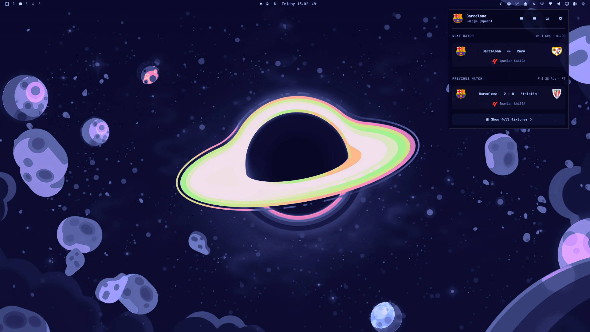

# FutBar — Football Widget for Omarchy


[](LICENSE)
[](manifest.json)

**FutBar** is a live football companion and match center engineered for Omarchy. Track live fixtures, tactical pitch formations with athlete kits, minute-by-minute match timelines, head-to-head records, league standings, player leaderboards, and real-time desktop event notifications seamlessly from your top bar. Powered directly by ESPN's public endpoints with zero API costs, no authentication keys, and no account setup required.



---

## Screenshots

| Club Overview | Tactical Pitch & Lineups |
| :---: | :---: |
|  |  |

| Match Statistics & Leaders | League Matchweek Fixtures |
| :---: | :---: |
|  |  |

| Player Stats & Leaderboards | Searchable Club Picker |
| :---: | :---: |
|  |  |

---

## Features

- **Top Bar Integration**: Minimalist soccer icon with live match state indicators, pulse animations during updates, and rich tooltip summaries on hover.
- **Comprehensive Match Center**: Live match scorecard, match status (pre-match, live, half-time, extra-time, penalties, full-time), goal scorers, and series notes.
- **Tactical Pitch & Lineups**: Full tactical pitch view featuring starting XI formations, athlete jersey kit numbers/graphics, substitutes, and live player ratings.
- **Match Timeline & Events**: Visual minute-by-minute timeline tracking goals, penalties, yellow/red cards, substitutions, and half-time/full-time milestones.
- **Head-to-Head & Team Form**: Detailed past encounter history, win/draw/loss counts, and recent form guide.
- **Match Commentary**: Reverse-chronological commentary during and after a match, where ESPN provides it.
- **League News**: Thumbnail cards with followed-club filtering and an in-panel reader showing a larger photo, image credit, headline, and ESPN summary. Full articles open on ESPN.
- **Rating Provenance**: An asterisk identifies ratings estimated by FutBar rather than supplied by ESPN.
- **TV Broadcasts & Where to Watch**: Official broadcast and streaming channel pills directly in match overview.
- **Editorial Match Stories & Recaps**: Previews, journalist bylines, and in-depth match recaps.
- **Penalty Shootout Spot-Kick Tracker**: Complete spot-kick sequences displaying taker names and scored or missed status glyphs.
- **Win Probability Breakdown**: Pre-match and live win probability bar indicating home, draw, and away odds distribution.
- **Multi-Day Match Navigation**: Seamless Yesterday, Today, and Tomorrow day filtering across global soccer fixtures.
- **League Standings with Rank Deltas**: Comprehensive standings tables with rank movement indicators (climbers and fallers) alongside qualification and relegation zones.
- **Player Leaderboards**: Top scorers, assist leaders, and disciplinary card rankings.
- **Live Activity Match Tracking**: Toggle match following to receive instant desktop notifications (`notify-send`) on goals, cards, and period changes.
- **Trending & Live Global Matches**: Dedicated view tracking live, international, and top-tier tournament matches worldwide with live scores, competition badges, quick search, and direct match center navigation.
- **Seamless Club & League Switching**: In-panel search and dropdown picker to switch followed teams or browse across global competitions.

---

## Installation & Setup

### Install Plugin
```bash
omarchy plugin add https://github.com/AlwaysRead/omarchy-futbar-plugin.git --enable
```

### Position on Bar (Optional)
```bash
omarchy bar move devbook.futbar --section right
```

### Set Default Club & League (Optional)
You can choose your favorite team and league directly in the panel UI, or configure via CLI:
```bash
omarchy plugin config devbook.futbar set teamName "Barcelona" league "esp.1"
```

### Remove Plugin
```bash
omarchy plugin remove devbook.futbar
```

---

## Controls & Shortcuts

| Action | Shortcut / Control |
| :--- | :--- |
| **Open / Close Panel** | Click bar icon or configure custom Hyprland keybind |
| **Quick Tooltip** | Hover over bar icon for live scores & kickoff times |
| **Instant Refresh** | Middle-click bar icon or press <kbd>r</kbd> |
| **Close Panel** | <kbd>Escape</kbd> |
| **Cycle Panels** | <kbd>Tab</kbd> / <kbd>Shift</kbd> + <kbd>Tab</kbd> |
| **Follow Match** | Click "Follow" button in match card or detail header |
| **Trending & Live Matches** | Press <kbd>l</kbd> or click flame icon |
| **Search Club / League** | Press <kbd>/</kbd> |
| **Standings / Table** | Press <kbd>t</kbd> |
| **Player / League Stats** | Press <kbd>s</kbd> |
| **Fixtures / Matches** | Press <kbd>m</kbd> |
| **News** | Press <kbd>n</kbd> |
| **Settings / Preferences** | Press <kbd>p</kbd> |
| **Switch Followed Tabs** | <kbd>1</kbd>–<kbd>9</kbd> |

---

## ESPN news

Use the news icon in the panel header for ESPN's general football feed across
competitions. News is independent of the selected league, player, or followed clubs.
Click a news card to open its photo and summary. Back or Escape returns to the
feed; “Read on ESPN” opens the full article. Full article text is not supplied
by this feed.

The news view fetches only while visible, keeps the last good response on refresh
failure, shows retry guidance, and discards responses from an old selection.
Spoiler mode requires an explicit panel-session reveal before showing results,
news, form, standings, statistics, or match details. Closing the panel or changing
club/league resets the reveal. Desktop notifications and bar scores/tooltips
remain protected even after revealing panel content.

## Everyday controls

In Settings, optional **5/15/30-minute reminders**, fixture-change alerts, and
lineup-available alerts refresh followed schedules every five minutes. Lineup
checks run every minute for at most six matches within two hours of kickoff.
These features are off by default. Notification scope, club muting, local quiet
hours and snooze apply to alerts. Reminders are best effort: FutBar must be
running before the due time and have fresh schedule data. Sent reminders persist
across reloads; changes to kickoff time use a new reminder identity. Initial
fixture/lineup snapshots are silent. Available starters do not establish official
lineup confirmation.

Profile pages offer a **Compare players/clubs** card. Pin two players or clubs to retain
side-by-side snapshots of their displayed statistics. Update a pinned profile in place,
remove either pin individually, or clear both; a third profile never replaces a pin
automatically. Players require a selected
season/tournament; different or unknown contexts are flagged. Missing values stay
unknown, and no per-90 estimates or rankings are invented. The existing player
Matches view includes season navigation, ESPN competition selection, refresh/retry
and a small, explicitly estimated rating trend. ESPN coverage varies by player,
season and competition; unavailable statistics stay unknown. The displayed rating
is FutBar’s local heuristic from available goals, assists and shots on target,
not an official ESPN rating.

Settings also includes compact/comfortable spacing, reduced motion, shortcut help,
versioned settings backup/restore, and a selectable redacted diagnostics report.
Backups use `~/.local/state/omarchy/futbar-settings-backup.json`, are limited to
64 KiB, and validate supported settings and followed tabs before an explicit
restore confirmation. Transient state, caches and notification history are excluded.
Navigation retains bounded, per-view scroll positions for the current session.
Refresh, cached-data and update-time feedback appears faintly in one pinned
footer at the bottom of the floating window for five seconds;
errors and cached-data notices remain visible.

## Image loading

Remote images require `python3` (standard library only). FutBar accepts static PNGs
from `https://a.espncdn.com`, downloads at most 512 KiB per image, and validates PNG
structure, checksums, and dimensions (at most 1024 × 1024) before passing image data
to Qt. Redirects, animated PNGs, and other formats are rejected; unavailable images
show a stable local placeholder. Ancillary metadata is stripped before decoding. Four downloads can run at once, each with a ten-second deadline.
The shared image cache holds at most 128 entries and 8 MiB of encoded data for five
minutes. No remote image URL is passed directly to the shell's image decoder.
Lineup jersey URLs matching ESPN's specific soccer stitcher endpoint are routed
through the same allowed CDN's resizer to produce 128px PNGs; the original 1440px
images do not reach Qt.

The network policy, runtime dependencies, project structure, and verification
commands are documented in [SECURITY.md](SECURITY.md).

News photos can also use JPEGs from the same ESPN CDN. The optional `magick`
command (ImageMagick) converts them in a resource-limited subprocess to small,
metadata-free PNGs before Qt receives them. Missing, oversized, or unsupported
photos show a placeholder. No new network hosts are allowed.

## Optional Dependencies

- **`imagemagick` (`magick`)**: JPEG news-photo decoding. Without it, JPEG photos show placeholders; text and PNG images still work.
- **`libnotify` (`notify-send`)**: Required for desktop match event notifications (goals, cards, half-time, full-time). Pre-installed on standard Linux desktop distributions (e.g. `libnotify` package).

---

## Popular League Codes

| League | ESPN Code |
| :--- | :--- |
| **Premier League** | `eng.1` |
| **LaLiga** | `esp.1` |
| **Serie A** | `ita.1` |
| **Bundesliga** | `ger.1` |
| **Ligue 1** | `fra.1` |
| **UEFA Champions League** | `uefa.champions` |
| **UEFA Europa League** | `uefa.europa` |
| **Major League Soccer (MLS)** | `usa.1` |
| **Brasileirão** | `bra.1` |
| **Eredivisie** | `ned.1` |
| **Liga Portugal** | `por.1` |

---

## License

This project is licensed under the [MIT License](LICENSE).

## Development layout

- `qml/`: bar entry point, panel, feature views, request controllers, shared components, data, and services.
- `lib/`: bounded HTTP, image validation, and statistics helpers.
- `tests/`: security regressions and Quickshell runtime checks.
- `docs/`: architecture and contributor guidance.
- `assets/`: documentation screenshots.

See [the architecture guide](docs/architecture.md) for the full file tree and
[SECURITY.md](SECURITY.md#checks) for validation commands.

See [the roadmap](docs/roadmap.md) for prioritized hardening, UI/UX, quality-of-life,
and ESPN API feature proposals with endpoint evidence and coverage limitations.

## Runtime verification

CI runs the full test suite under Qt 6/Quickshell and a headless Wayland compositor,
using a pinned Omarchy source revision. The integration job rejects skipped tests
and runs with network access disabled. Fixtures cover request cancellation, stale
refreshes, history filters, keyboard input, image fallbacks and narrow/large-font
layouts. See [architecture](docs/architecture.md) and the reproducible
[performance baseline](docs/performance.md).
